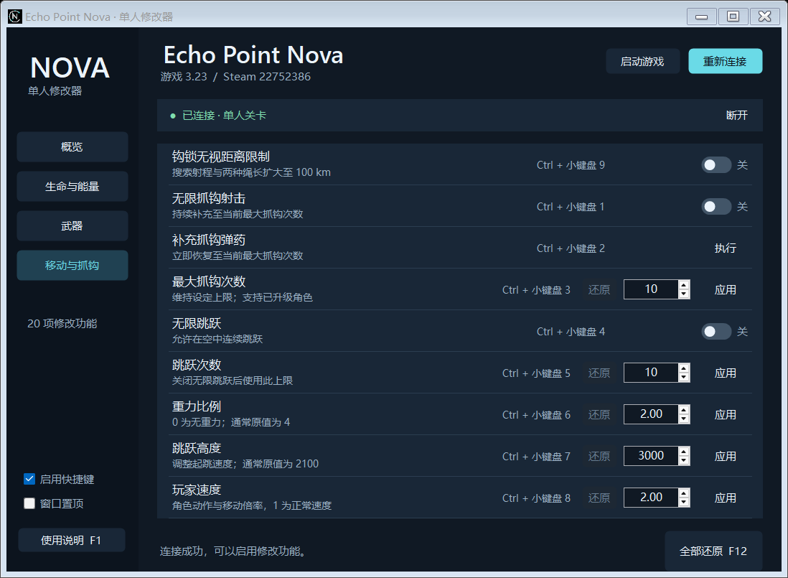

# Echo Point Nova Trainer

为 **Echo Point Nova 3.23 / Steam build 22752386** 制作的 Windows x64 中文单人修改器。原生 WinForms 界面，共 20 项功能，主程序为单个 EXE。

**[下载最新版](https://github.com/1458883618/echo-point-nova-trainer/releases/latest)** · [使用说明](docs/使用说明.md) · [测试报告](docs/测试报告.md)



## 下载与使用

1. 在 [Releases](https://github.com/1458883618/echo-point-nova-trainer/releases) 下载 `EchoPointNovaTrainer.exe`，或下载包含说明文件的 Windows ZIP 包。
2. 启动游戏，进入单人关卡，再运行修改器。
3. 等待“已连接 · 单人关卡”，按需开启功能或应用数值。
4. 按 **F12 全部还原**，或正常关闭修改器，恢复持续修改的属性。

资源补充属于一次性操作，不会在关闭时倒扣。所有开关在每次启动时均关闭。F1 打开内置说明，可以更改游戏安装目录。快捷键使用小键盘，需要开启 Num Lock。

运行环境：Windows x64 与 .NET Framework 4.x。程序按当前用户权限启动，不主动请求管理员权限。连接前严格核对游戏文件指纹；其他游戏版本需要重新适配。

## 功能

| 分组 | 项目 |
|---|---|
| 生命与能量（9 项） | 无限生命、补充生命、低生命值、无限法力、补充法力、法力不足、法力恢复速度、极限肾上腺素、设定肾上腺素 |
| 武器（2 项） | 无限弹药、设置当前枪械的弹匣与备弹 |
| 移动与抓钩（9 项） | 无限抓钩射击、补充抓钩、最大抓钩次数、无限跳跃、跳跃次数、重力比例、跳跃高度、玩家速度、钩锁无视距离限制 |

钩锁距离功能将搜索射程和两种绳长扩大至 **100 km**，仍需命中已经加载的可抓取实体。实际操作验证完成了约 **184.33 米**外目标的命中和牵引；100 km 是参数上限，未声称实际牵引测试达到这一距离。

玩家速度调整角色时间倍率，同时影响移动、动作和相关计时。跳跃高度调整起跳速度。多人连接检测会暂停修改；本项目仅面向本机单人游戏，未进入多人房间验证。

## 从源码构建

无需 NuGet 或额外 UI 依赖，使用 Windows 自带路径中的 .NET Framework C# 编译器：

```powershell
powershell -NoProfile -ExecutionPolicy Bypass -File .\scripts\build.ps1
```

输出：`dist/EchoPointNovaTrainer.exe`。执行策略参数只作用于当前进程，不更改系统设置。脚本兼容 Windows PowerShell 5.1 与 PowerShell 7，并显式使用 UTF-8 编译中文源码。

## 测试

```powershell
# 底层测试：无需启动游戏
powershell -NoProfile -ExecutionPolicy Bypass -File .\scripts\test.ps1

# 真实游戏测试：先关闭修改器，在适配版本中进入单人关卡并装备枪械
powershell -NoProfile -ExecutionPolicy Bypass -File .\scripts\test.ps1 -Live
```

真实游戏测试会修改当前角色和武器参数，并按对象身份恢复测试前值，适合在专门用于测试的存档中运行。

初版记录：15 项底层测试与 14 组真实游戏进程测试通过；实际操作验证覆盖远距离钩锁、开火补弹与连续空中跳跃。迁移发布时重新执行构建及底层测试，原游戏操作记录保留于 [测试报告](docs/测试报告.md)，不将它们当作本轮重新游玩所得的结果。

## 目录

```text
src/             C# 应用与内存访问逻辑
tests/           底层、引擎和真实游戏测试
scripts/         构建、测试与图标生成脚本
assets/          图标与应用清单
docs/            使用说明、测试报告与界面预览
dist/            本地构建及发布文件（不提交）
```

个人存档、开发临时数据及本机认证信息通过 `.gitignore` 排除。发布文件放在带版本号的 GitHub Release 中；Git 仓库保存源码与文档。
